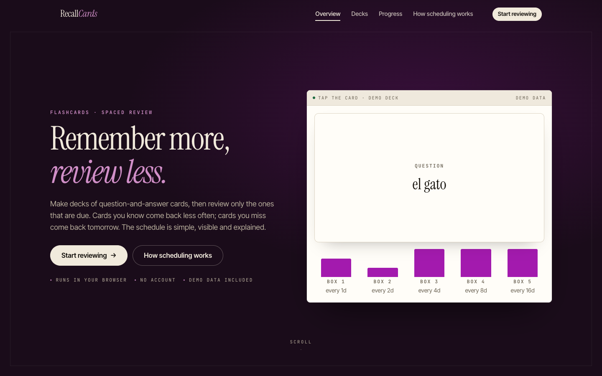
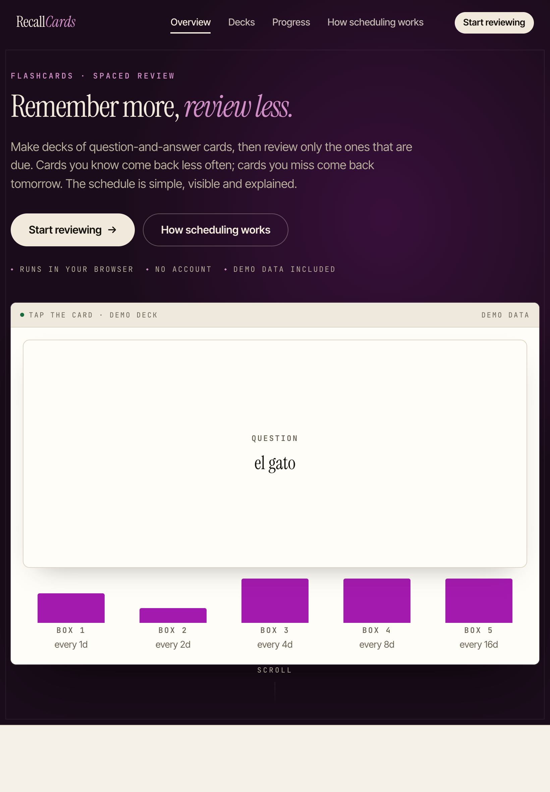
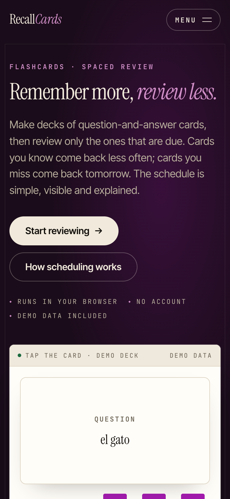
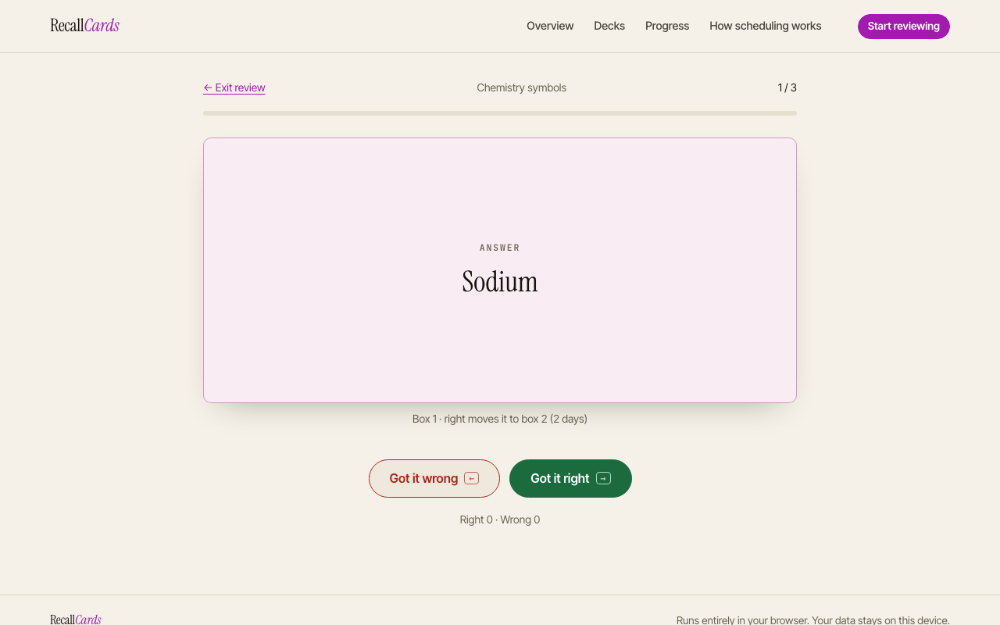
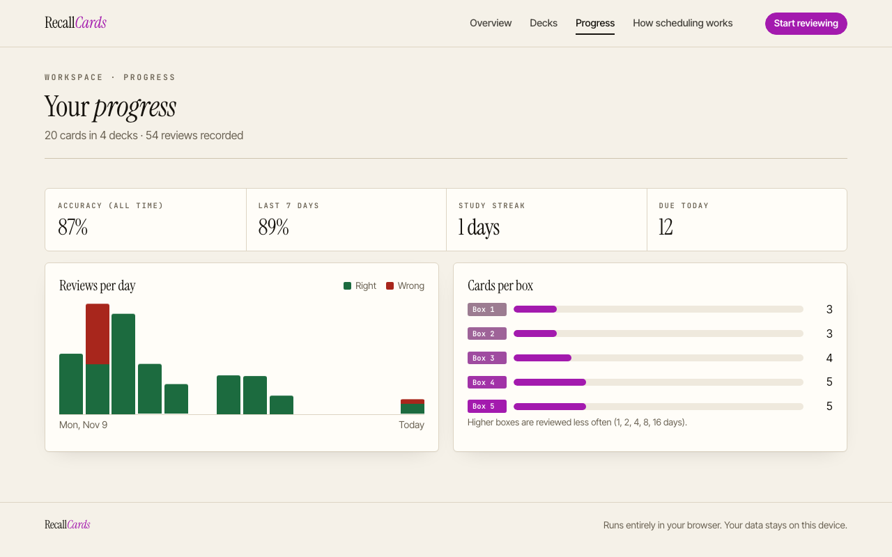
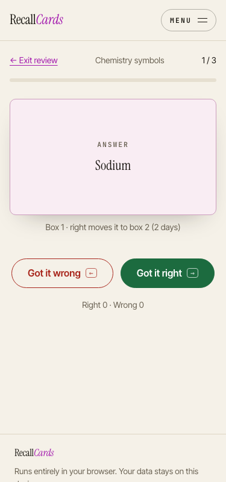

# Recall Cards

<!-- screenshots:start -->
<p align="center">
  
</p>
<p align="center">
  
  &nbsp;&nbsp;
  
</p>
<p align="center"><sub>Mac (1440×900) · Tablet (820×1180) · Phone (390×844)</sub></p>
<!-- screenshots:end -->

Flashcards with a focused review mode and a simple, documented spaced-review schedule (Leitner boxes). Create decks, add or import cards with tags, review only what's due, and track accuracy and progress.

**Live demo:** [https://kavishtolani.github.io/recall-cards/](https://kavishtolani.github.io/recall-cards/) — runs entirely in your browser; demo data is fictional and labelled.



| Progress | Mobile |
| --- | --- |
|  |  |

## Run it

```bash
npm install
npm run dev        # http://localhost:5121
npm test
npm run build
npm run test:e2e   # Playwright smoke test (npm run e2e:install once if Chromium is missing)
```

## Main workflow

1. **Decks** opens with three labelled demo decks and two weeks of practice history; some cards are due today. **Remove demo decks** shows the empty state.
2. Create a deck (unique, non-empty name), open it, and add cards (front/back/tags; duplicate fronts rejected) or **Import many cards** (`front<TAB>back`, `front - back` or `front,back` per line; duplicates and unreadable lines reported).
3. **Review** — one card at a time with nothing else on screen. Show the answer (button, click or **Space**), then **Got it wrong** (← or 1) / **Got it right** (→ or 2). A progress bar and running tally are shown; the session ends with a summary.
4. **Progress** — all-time and 7-day accuracy, study streak, due today, a 14-day right/wrong chart with tooltips, and cards per box.
5. **How scheduling works** explains the exact rules.

## Review schedule (Leitner)

New cards start in box 1. Right → up one box (max 5); wrong → back to box 1. Next review after 1, 2, 4, 8 or 16 days depending on the box. Due cards are shown lowest box first. Editing a card's text doesn't change its schedule.

## Tests

- `src/lib/srs.test.ts` — promotion/reset and intervals, due ordering, next due date, accuracy, daily history, box counts, streaks, validation, import parsing.
- `src/App.test.tsx` — demo decks, full keyboard review session with summary, card validation and import, empty states.
- `e2e/smoke.spec.ts` — create deck → import → review with buttons and keyboard → reload → progress chart; strict 375px checks.

## Limitations

- Fixed Leitner intervals; not an adaptive algorithm (SM-2/FSRS).
- Text-only cards (no images, audio or formatting).
- One device; no sync or sharing of decks.

## Future improvements

- Optional adaptive scheduling, image cards, and deck export/import as CSV or Anki-compatible text.

## Licence

MIT — see [LICENSE](LICENSE).
